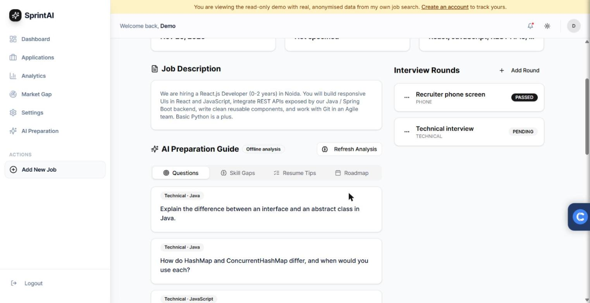
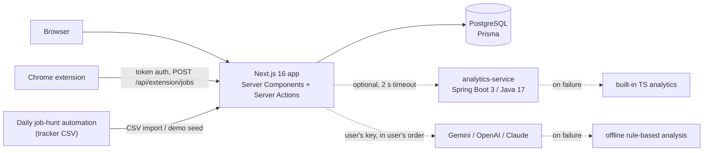

# InterviewSprint AI

**Run your job search like a data project.** Track every application, see which channels actually reply,
learn which skills the market asks for, and prepare for each interview with AI.

**Live demo:** https://interviewsprint-ai.vercel.app (click **Try the live demo**, no sign-up needed)

The demo account holds real, anonymised data from my own job search in November 2026. I ran it with an
automated daily routine that applied through Indian job portals and emailed recruiters, and logged every job it
screened. Recruiter names, emails, phone numbers and notes are removed; company and role names are kept.

## What the data showed

| | |
|---|---|
| Applications tracked | **194** over 8 active days (Naukri, Instahyre, Wellfound, LinkedIn, Cutshort, Indeed, direct email) |
| Jobs screened for the market analysis | **524**, each with the skills and experience it required |
| Best channel | **Emailing recruiters directly: 14.3% response rate**, against under 5% on every job portal |
| Most demanded skills | React (in 48% of screened jobs), Node.js (36%), SQL (22%), TypeScript (19%) |
| Skills to learn next | **Python** was the only skill I was missing in 29 of the screened jobs, followed by **Spring Boot** (19) |

Those findings changed how I searched: more direct emails and referrals, fewer portal applications, and a
Spring Boot service in this project to close the second-biggest gap.

## Screenshots

| Job-hunt analytics | Market gap |
|---|---|
|  |  |



## Features

- **Applications & interview rounds** – full CRUD with status tracking, filters and interview-round timeline.
- **Job-hunt analytics** – applications per day, funnel (applied → responded → interview → offer),
  applications and response rate by portal.
- **Market gap** – which skills the screened jobs ask for (highlighting the ones you have), why jobs were
  skipped, experience asked for, and the missing skills that would unlock the most jobs.
- **AI interview prep** – per job description: likely questions, skill gaps, resume tips and a prep roadmap.
- **Bring your own AI key** – users pick **Google Gemini** (free tier), **OpenAI** or **Anthropic Claude**, paste
  their own key (tested before saving, encrypted with AES-256-GCM, never sent back to the browser) and set a
  fallback order. Each analysis shows which provider and model produced it and how many tokens it used.
- **Chrome extension** – one click on any job posting (LinkedIn, Naukri, Instahyre, Wellfound, Indeed, Cutshort,
  company sites with schema.org data) saves it to your account, shows your skill match and missing skills, and can
  generate AI prep straight away. See [extension/README.md](extension/README.md).
- **CSV import** – bring in applications and screened jobs from any tracker; re-imports are idempotent.
- **Read-only demo account** – every write action is blocked for it on the server.

## Built to degrade gracefully

Two parts of the system are optional, and neither can take the app down:

- **AI providers.** Analysis runs through a fallback chain: the user's own providers in their chosen order
  (Gemini / OpenAI / Claude, each through its official SDK with a timeout, one retry and Zod-validated output), then
  the site's own key if configured, then an **offline analysis** built from the job description and the user's
  skills, labelled as such. A provider that just failed is skipped for 60 seconds per user, so nobody waits for the
  same timeout twice. A missing or broken key can never crash a page.
- **Java analytics service.** When `ANALYTICS_SERVICE_URL` is set, the Analytics and Market Gap pages ask the
  Spring Boot service for their summaries with a 2-second timeout and validate the reply. On any failure the same
  summary is computed in the app. The page shows which engine answered.

## Architecture



## Tech stack

| Layer | Technology |
|---|---|
| Web app | Next.js 16 (App Router, Server Components, Server Actions), React 19, TypeScript |
| UI | Tailwind CSS v4, shadcn/ui, Recharts |
| Data | PostgreSQL, Prisma ORM (migrations applied on deploy) |
| Auth | Auth.js v5: Google OAuth and email/password |
| AI | Bring-your-own-key Gemini (@google/genai), OpenAI (openai), Claude (@anthropic-ai/sdk structured outputs); Zod validation; offline fallback |
| Analytics service | Java 17, Spring Boot 3, Bean Validation, Actuator, JUnit 5, Docker |
| Browser extension | Chrome Manifest V3 (activeTab + scripting), personal access tokens |
| Quality | Vitest + jsdom (web, extension extractor), JUnit + MockMvc (service), GitHub Actions CI |
| Hosting | Vercel |

## Project structure

```
app/                 Next.js routes: landing, auth, dashboard (applications, analytics, market, prep, settings)
actions/             Server actions: applications, interview rounds, AI analysis, CSV import, skills
components/          UI and feature components (analytics charts, settings forms, ...)
lib/                 analytics.ts, market.ts, skills.ts, csv.ts, import.ts, ai/analysis.ts, analytics-client.ts
prisma/              schema, migrations, demo seed (seed-demo.ts + demo/*.json)
analytics-service/   Spring Boot service (see its README)
tests/               Vitest unit tests
scripts/migrate.mjs  build-time migration runner
```

## Run locally

```bash
npm install
cp .env.example .env.local      # fill in DATABASE_URL and AUTH_SECRET at least
npx prisma migrate deploy
npm run seed:demo               # optional: loads the demo account
npm run dev
```

`OPENAI_API_KEY` and `ANALYTICS_SERVICE_URL` are optional; without them the app uses its offline analysis and
built-in analytics. To run the Java service, see [analytics-service/README.md](analytics-service/README.md).

## Tests

```bash
npm test                        # Vitest: analytics, market gap, CSV import, AI fallback
npm run typecheck
cd analytics-service && mvn verify   # JUnit + MockMvc
```

CI runs all of these on every push.

---

Built by **Shubh Maheshwari** · [LinkedIn](https://www.linkedin.com/in/shubh-maheshwari/) · [Portfolio](https://shubhmaheshwari.vercel.app/)
